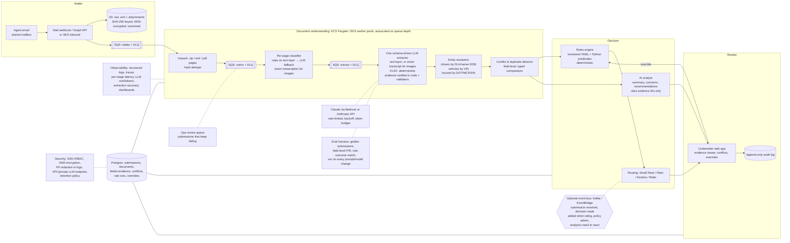

# Knight Insurance – Commercial Auto Intake Prototype: PLAN

Status (11/02/2026): **built and running.** Branch `build`; the pipeline runs end to end on the sample on PostgreSQL 18 (D-33); all 42 guideline rules are implemented; eval 87/87 on the sample (a regression check) and on two held-out submissions: 49/72 (first measurement; 72/72 after fixes, D-34) and 64/70 (second, run once on unchanged code, decision correct; 70/71 after fixes); 115 tests; held-out #3 (clean fleet) 69/69 first run, D-39; held-out #4 (forwarded email) 66/67 first run, 67/67 after a keyword fix, D-46; full check of every action in the app, three review fixes, D-47; draft reply to the agent D-48; commodities sorted by the model, evals unchanged and look-alikes 12/12 vs 8/12, D-49; duplicate code removed with output unchanged, D-50; LangGraph (stages as nodes, Postgres checkpoints, review as interrupt/resume) and LangChain's ChatAnthropic, switchable and proven equivalent, D-51; Langfuse tracing with scores, masking and a dashboard, D-52; old paths kept as rollback switches, duplicates removed, full check, heartbeat hardened, D-53; disagreements also marked on the values, D-54; conflict decisions click-tested, refused actions return to the page, D-55; emails inside submissions and upload sender/note D-40; To review in underwriter language, rule-code legend, conflict suggestions explained D-41 to D-43; code-review fixes D-35; queue, workers and parallel page calls D-36. Section 5b below is a claims check against the code. Every file in `candidate_materials/` was read by hand (text layers extracted, all image-only pages rendered and viewed).
The decisions log lives in [DECISIONS.md](DECISIONS.md): D-01 to D-55 are DECIDED (D-23 superseded by D-31). Every real model run and its cost is in [RUN_LOG.md](RUN_LOG.md).

Reference dates used below: application date **10/22/2026** (KNIGHT.xlsx E7), requested effective date **12/15/2026**, today **10/31/2026**.

---

## 1. Brief: requirements and demo checklist

### 1.1 Business requirements (system must…)
- [x] R1 Receive emails and attachments (agents/brokers submit by email)
- [x] R2 Process and classify all submitted documents
- [x] R3 Extract relevant information from the package
- [x] R4 Analyze with AI using industry knowledge; give information about the submission
- [x] R5 Apply business rules and underwriting guidelines (source = Knight_Guideline(Mockup).docx)
- [x] R6 Present final results in a web application

### 1.2 Real-world conditions it must handle
- [x] Misleading or wrong file names: classify by content, not by name
- [x] Mixed formats: digital PDFs, photographed PDFs, scans, images, handwriting  (handwriting: a phone photo of a handwritten agent note, every value read correctly; RUN_LOG HW1)
- [x] Duplicate information across documents
- [x] Conflicting information: vehicle counts, DL vs MVR, business info, dates, VINs, addresses, policy info

### 1.3 Workflow steps
- [x] Intake: receive and store the email and attachments, work out what was submitted
- [x] Document understanding: identify types, extract, link across documents, find missing info, detect duplicates and conflicts
- [x] AI processing: summarize, flag underwriting concerns, detect inconsistencies, recommend, **assign confidence to extracted values and to recommendations**
- [x] Rules: flag incomplete, route to team, find prohibited risks, escalate for manual review
- [x] Results view: summary, extracted info, missing info, conflicts, AI findings, rule outcomes, recommended next actions

### 1.4 Things to explain (video narration and interview)
- [ ] Architecture: email ingestion, document processing, AI services, business rules, data storage, UI, workflow orchestration
- [ ] AI design: classification, extraction, confidence, conflict handling, human review
- [ ] Rules and workflow: how rules are maintained, how AI output feeds rules, exceptions, auditability
- [ ] Scalability and reliability at production scale
- [ ] Security and compliance: sensitive data, access control, encryption, audit logging, regulation
- [x] UX for underwriters and operations teams (built: §5b-2)
- [ ] High-level solution, design decisions, **assumptions, risks, tradeoffs**
- [ ] **Clarifying questions I would ask, and the assumptions I made in their place**
- [ ] Real-world handling: poor-quality docs, missing info, conflicting data, scale

### 1.5 Prototype must demonstrate
- [x] Email intake (real or simulated)
- [x] Multiple attachment types (PDF text, PDF image, XLSX; images)
- [x] Document classification
- [x] Information extraction
- [x] Photographed and scanned documents
- [x] Conflicting-information detection
- [x] AI analysis and recommendations
- [x] Business rule execution
- [x] Final results presentation

### 1.6 Video (5–15 min, due Mon 11/02/2026 11:59 PM)
- [ ] Live demo
- [ ] Overall architecture
- [ ] Design decisions and assumptions
- [ ] Complete end-to-end workflow
- [ ] Classification · extraction · poor-quality documents · conflicts · AI recommendations · business rules · results presentation

> The brief says rules, constraints and success criteria were left out on purpose. The clarifying-questions list (section 4) is a graded deliverable, not housekeeping.

---

## 2. Guideline rules, written so plain code can implement them

Source: Knight_Guideline(Mockup).docx. The two copies (root and pack) are byte-identical (same MD5).
Outcomes: `DECLINE` > `REFER` > `PASS`. Final decision = worst outcome. Routing to a team happens alongside the decision.
Proposed rule config shape: `rules/knight_trucking_v1.yaml` with `id, version, source_clause, inputs, params, outcome`.

### 2.1 Appetite and coverage
| ID | Rule (implementable) | Outcome | Notes |
|---|---|---|---|
| APP-01 | Every scheduled power unit has `vehicle_type ∈ {tractor/semi}`. | REFER if not | "Target risk" describes what is wanted. It doesn't say what happens otherwise. |
| APP-02 | No unit with `vehicle_type ∈ {straight truck, tow truck, dump truck, concrete mixer/pumper, crane, mobile equipment}` (any GVW). | DECLINE | "Not eligible". See AMB-1 on box trucks. |
| APP-03 | `operations` is interstate (`radius` or IFTA has more than one jurisdiction). | REFER if intrastate only | "across state lines" |
| APP-04 | `commodities` is general freight (none of the prohibited cargo in PRO-*). | via PRO-* | |
| COV-01 | `al_deductible_requested` must be 0 or none. | REFER (coverage not offerable) | "AL deductibles: Not allowed" |
| COV-02 | If `apd_quote_requested = true`, it cannot be offered. | FLAG / next action: tell the agent APD is not available | Not a decline of the account (AMB-8) |
| NV-01 | If `new_venture` and `entity ∈ {sole prop, partnership, LLC}`, require `owner_cdl_years ≥ 2` and a resume or experience letter on file. | REFER if missing | "new venture" is not defined (AMB-3) |
| NV-02 | If `new_venture` and `entity = corporation`. | REFER | "subject to underwriter review" |

### 2.2 States
| ID | Rule | Outcome |
|---|---|---|
| ST-01 | `domicile_state ∈ {AL, AZ, AR, CA, SC, SD, TN, TX, UT, VA, WV, WI, WY}` | DECLINE if not (PRO "non-listed states") |
| ST-02 | If `domicile_state = TX`, operations must be north of I-10. | REFER if unknown, DECLINE if south |
| ST-03 | If `domicile_state = IL`, selective. | REFER |
| ST-04 | Operating states (from IFTA jurisdictions) ⊆ the available list? | REFER by default; `operating_states_mode: decline` flips it to DECLINE (D-05) |

### 2.3 Submission completeness (any failure: REFER, "missing required documents")
| ID | Rule |
|---|---|
| SUB-01 | Application present with `fein` or `ssn` (FEIN: 9 digits; SSN: 9 digits) |
| SUB-02 | Application has `mc_number` or docket number |
| SUB-03 | Loss runs: every run's `run_date` within 60 days of the anchor date (AMB-4) |
| SUB-04 | Loss runs cover the expiring term plus ≥3 prior annual terms (AL; AMB-6 on whether MTC counts) |
| SUB-05 | IFTA: the 4 most recent quarters that have been filed or come due as of the anchor date, all present |
| SUB-06 | Driver schedule present |
| SUB-07 | Each scheduled driver has an MVR with `order_date` within 90 days of the application date |
| SUB-08 | Vehicle schedule present. Every unit has `year`, `make`, a `vin` of exactly 17 characters (also check the ISO 3779 check digit), and a `stated_value` |

### 2.4 Driver rules (evaluated per driver)
| ID | Rule | Outcome |
|---|---|---|
| DRV-01 | Holds a valid U.S. driver license (MVR status VALID, not expired at the anchor date) | REFER (AMB-5) |
| DRV-02 | Holds a valid CDL (class A/B commercial) | REFER (AMB-5) |
| DRV-03 | CDL experience ≥ 2 years in US/Canada, from the **earliest documented CDL evidence** to the anchor date (D-26): a commercial license's issue date (MVR or photographed card), a `cdl_issue_date`, or an MVR history event naming a CDL. A lower bound: the MVR "Iss Date" is only the current card and "first issued" covers any license, so neither is used as the start. No evidence → NOT_EVALUATED. | REFER |
| DRV-04 | `age ≥ 23` at the anchor date | REFER |
| DRV-05 | If `age ≥ 65`, a DOT medical exam report is on file | REFER if missing |
| DRV-06 | Points over the last 36 months ≤ 6 **and** points over the last 12 months ≤ 4 | REFER ("generally"). AMB-7 on how points are counted |
| DRV-07 | No DUI/DWI in the last 60 months | DECLINE |
| DRV-08 | None ever (no lookback given): vehicular homicide/assault, negligent/reckless driving, speeding > 30 mph over the limit, hit-and-run, fleeing/eluding, motor-vehicle felony, passing a stopped school bus | DECLINE (lookback AMB-9) |

Violation matching: keyword list plus state violation-code map (e.g. NJ/CA codes). The LLM may *suggest* a category, which shows as "AI-suggested". Only deterministic matches drive DECLINE.

### 2.5 Prohibited exposures (any one: DECLINE)
PRO-01 hazmat · PRO-02 lithium-battery cargo · PRO-03 operations within 50 miles of the US/Mexico border · PRO-04 non-listed states (ST-01/04) · PRO-05 serious SAFER violations · PRO-06 towing/recovery · PRO-07 intermodal/container · PRO-08 waste disposal.
Inputs come from application answers plus commodity text. Where the answer is *unknown* (PRO-03 and PRO-05 for this account), the result is **REFER with "cannot determine"**, never PASS.

### 2.6 Selective exposures (REFER)
| ID | Rule |
|---|---|
| SEL-01 | Auto hauler (commodity or operation) → REFER |
| SEL-02 | Any box truck or transit van → minimum premium $250,000 → REFER |
| SEL-03 | If `requested_premium_per_power_unit < 13,000` then `power_units ≥ 20` is required. If premium is unknown, mark not evaluable. |

### 2.7 Prior insurance
| ID | Rule | Outcome |
|---|---|---|
| PRI-01 | Continuous commercial auto coverage for the 36 months before the anchor date | REFER if broken |
| PRI-02 | Any gap > 30 days between consecutive terms needs a written explanation before quoting | REFER (hold) |
| PRI-03 | Every prior term listed on the application has a loss run | REFER (missing docs) |

### 2.8 Routing
| ID | Rule |
|---|---|
| RTE-01 | `power_units` 1–10 → Small Fleet UW; ≥11 → Fleet UW. The count is a resolved value; if sources disagree, use the **higher** count and raise a conflict (AMB-10). |
| RTE-02 | Any DECLINE → decline. Missing docs, any conflict, or any other flag → REFER to UW manual review. Otherwise "ready to quote". |
| RTE-03 | "conflicting information → refer" means **every unresolved conflict is itself a referral reason**, so conflict detection feeds the rules engine directly. |

### 2.9 Ambiguous rules (each becomes a clarifying question in the video)
- **AMB-1** Straight trucks are "not eligible", yet box trucks and transit vans (which *are* straight trucks) are "selective, minimum premium $250k". Which wins?
- **AMB-2** "Available States" and "non-listed states": domicile/garaging only, or every state operated in? This decides the outcome for the sample (see 3.3).
- **AMB-3** What counts as a "new venture"? (Commonly < 3 years under current authority. Not stated.)
- **AMB-4** "Loss runs valued within 60 days" of what: application date, receipt date, quote date, or effective date? (Sample: 16 days from the app date, 70 from the effective date.)
- **AMB-5** Does failing the driver *baseline* (no CDL, under 2 yrs) count as an "unacceptable driver", which means DECLINE? Or is it a referral, given the driver could be excluded? The application form has an "Excluded" driver type.
- **AMB-6** Do the loss-run requirements apply to AL only or to every line (MTC/APD)?
- **AMB-7** Points: program points (a standard table) or state-assigned points? Count by violation date or conviction date? Do safe-driving point credits (NJ) reduce the total? Do accidents add points?
- **AMB-8** APD "not available" and AL deductible "not allowed": decline the submission, or quote AL only?
- **AMB-9** No lookback period for the unacceptable-history list other than DUI (5 yrs).
- **AMB-10** Which "power unit count" decides routing: scheduled, prior-policy, or IFTA-implied?
- **AMB-11** "Serious SAFER violations": no definition and no data source (needs an FMCSA SAFER/SMS lookup by DOT#).
- **AMB-12** "Generally no more than…" makes the points threshold a soft rule. Proposed: REFER, never DECLINE.
- **AMB-13** "Corporations subject to underwriter review" covers new-venture corporations only. Does it also apply to established corporations? (The text reads as new-venture only.)
- **AMB-14** Cargo/MTC is requested but the guideline is silent on cargo eligibility and limits.
- **AMB-15** "*TX: Accounts must operate north of Interstate 10": does this apply only to TX-domiciled accounts, or to any account operating in TX? This account has TX miles every quarter and lists TX as its farthest territory (D-28).

---

## 3. Inventory of the 15 files

The zip `Sample Submission - Cobalt Mesa Transport.zip` **is the sample submission**: it holds exactly the 15 files listed in the brief (CRC32 match), and the loose files beside it are an unpacked copy. Intake therefore has to **unpack zip attachments** (agents often send a single zip). Hash dedupe still matters in case an agent attaches both the zip and the loose files.
`Knight_Guideline(Mockup).docx` also appears inside the pack folder. It is reference material, not part of the submission.

### 3.1 What each file is
| # | File name | Real content | Format / text layer | Notes |
|---|---|---|---|---|
| 1 | AL 23-24.pdf | Auto liability loss run, Granite Peak, GAL7102318, 12/15/23–12/15/24, run 10/06/26 | Digital PDF, selectable text | 0 claims |
| 2 | AL 24-25.pdf | AL loss run GAL8100457, 12/15/24–12/15/25 | Digital, text | **2 claims, $77,459 incurred, 1 open BI ($40k reserve + $12.5k legal)**, both late-reported, one unreported driver + unreported unit |
| 3 | AL 25-26.pdf | AL loss run GAL9100219, 12/15/25–12/15/26 (current/expiring term) | Digital, text | 0 claims |
| 4 | MTC 23-24.pdf | **Letter**, not a loss run: "Midwest Freight Owners Association Inc" (WI), policy 23-MFO-40C00017 MTC, "no *paid* losses" 12/15/23–12/15/24 | Digital, text (ReportLab) | Different carrier and a different layout. Says "no paid losses", not "no claims". |
| 5 | MTC 24-25.pdf | Cargo loss run, Granite Peak GMC2990344, **12/16**/24–12/16/25, $2,500 ded | Digital, text | 0 claims |
| 6 | MTC 25-26.pdf | Cargo loss run GMC3990512, 12/16/25–12/16/26 | Digital, text | 0 claims |
| 7 | Q3 2025.pdf | CA CDTFA IFTA return, acct 247-918305, Jul–Sep 2025, 137,594 mi, $2,936.92 | **Image-only scan** (3 pp, no text layer) | Clean scan |
| 8 | Q4 2025.pdf | IFTA Oct–Dec 2025, 130,981 mi, $2,790.11 | **Image-only scan** (3 pp) | **Taxpayer "COBALT MESA TRANSPORT LLC"** |
| 9 | Q1 2026.pdf | IFTA Jan–Mar 2026, 142,087 mi, $3,464.20 + **penalty $346.42 + interest $134.80** = $3,945.42 | **Image-only scan** (3 pp) | Late filing or payment |
| 10 | Q2 2026.pdf | IFTA Apr–Jun 2026, 103,773 mi, $2,835.29 | **Image-only, photocopied/skewed**, lower quality (2 pp) | Hardest OCR case |
| 11 | COBALT MESA TRANSPORT INC - QUOTE FORM.pdf | Agency "Quick Quote Form" (generic, not Knight's) | Digital, text, checkboxes drawn as glyphs ("n" = ■) | Checkbox state needs layout or vision reading |
| 12 | COBALT MESA TRANSPORT INC - KNIGHT.xlsx | Knight commercial auto **application** (3 sheets: Application Info; Drivers and Vehicles; **hidden** "Lookups"). Embedded **"ONWARD INSURANCE" logo** | XLSX, formulas, booleans for checkboxes | Driver/vehicle tabs say "LIST ATTACHED". Created 2024-05 by "D. Okafor", modified 10/30/2026 ("Bayline Renewals") |
| 13 | DRIVER LIST - …xlsx | Driver schedule, 5 drivers, sheet `driver_export20261009` | XLSX | |
| 14 | VEHICLE LIST - …xlsx | Vehicle schedule, 4 tractors, **"Cost New" only (no stated value)**, plus a stray "TRAILER INTERCHANGE 50000" row | XLSX, `=SUM` TIV formula (193,000) | |
| 15 | MVR REPORT - …pdf | **Mixed bundle, 10 pp**: 5 current MVRs (10/09 and 10/13/26), **1 old duplicate MVR (Whitfield, 09/24/25, stamped "OLD MVR")**, 2 end-of-report pages, and **2 photographed driver licenses (pp 7 and 10)** | Digital text pages + **2 image-only photo pages** | Named "MVR" but also contains DL photos. This is the brief's "misnamed file" case **inside** one file, so classification has to run **per page**, not per file. |

Formats covered: digital PDF (9), image-only scan PDF (4), photo pages inside a PDF (2 pages), XLSX (3). No standalone image files or handwriting in the sample. Decided: add 2 clearly labelled synthetic test files, a phone-photo JPG and a blurred/corrupt file (D-13).

### 3.2 Extracted facts (ground truth for the eval set)
Applicant: COBALT MESA TRANSPORT INC, 4180 Tamarack Way, Lathrop CA 95330, DOT 9481307, MC 1987405, Corporation, For-Hire trucking, owner Devraj Sandhu, 209-555-0148.
Coverage asked: AL $1M (no deductible), UM 30/60, **APD quote: Yes**, **Cargo $100k: Yes**, **Reefer breakdown: Yes**, trailer interchange $50k (vehicle list only).

| Driver | DOB (list) | DOB (MVR / DL) | License | MVR date | Notes |
|---|---|---|---|---|---|
| Devraj Sandhu (owner) | 09/14/1979 | 09/14/1979 | CA C4471925, **Class C non-commercial** | 10/09/26 | **No CDL.** Clean. Scheduled as a driver. |
| Marcus J Whitfield | 03/22/1971 | blank on NJ MVR | NJ CDL A W382… | 10/09/26 **and** 09/24/25 (old) | Speeding 15–29 over, 06/07/2023, 4 pts (outside 36 mo of the app date); accident 02/11/2024, fault not determined; NJ point credits |
| Aleksandr P Volkov | 06/02/1983 | 06/02/1983 | NJ CDL A V619…, CDL issued 05/28/2022 (transfer from PA) | 10/09/26 | **CDL downgrade notice 12/18/2024**, cleared 01/29/2025. Driver in the **open BI claim 03/09/2025**. DL photo shows exp **06-02-2026** (old card; MVR shows renewed to 2030). DL middle name "PAVEL" vs "P". |
| Luis E Morales | **10/03/1991** | **10/30/1991** | CA CDL A M5520814, current CDL issued 06/04/2023, first licensed 2010 | 10/09/26 | Speeding (truck >55), 03/14/2025, 1 pt. "Duplicate license issued". |
| Nathaniel K Osei | 02/17/1987 | 02/17/1987 | CA CDL A O7314062 | 10/13/26 | DL photo: **exp 02/17/2025, ISS 01/06/2021, "LIMITED-TERM"** vs MVR iss 04/09/2025, exp 2030. Hired **10/19/2026**. |
| *Kevin Brandt* | – | DOB 11/02/1976 (loss run) | – | none | **Unlisted driver** in the 06/21/2025 claim |

| Unit | Vehicle list | Other sources |
|---|---|---|
| 1 | 2022 Volvo 4V4NC9EH4NN301742, $82k | VIN check digit OK |
| 2 | 2020 Volvo 4V4NC9EH9LN248615, $48k | **Loss run calls the same VIN a "2020 FREIGHTLINER"** (the 4V4 WMI is Volvo) |
| 3 | 2019 International 3HSDZAPR0KN617093, $41k | OK |
| 4 | 2017 Freightliner **3AKJGLD59HSKR736** | **16 characters, invalid VIN** |
| – | *2021 Peterbilt 1XPBD49X5MD735204* | **Unreported unit** in the 06/21/2025 claim. Not on the schedule. |

### 3.3 Inconsistencies, duplicates and gaps (what the demo should catch)
**Conflicts**
1. **Named insured entity**: "…TRANSPORT INC" (app, quote, loss runs, 3 IFTAs) vs **"…TRANSPORT LLC"** (Q4 2025 IFTA). Entity type matters for the new-venture rule.
2. **Power-unit count**: vehicle list 4 · application fleet tab 1 row "TRACTOR" · quote prior-policy table **5 units** for the current term · claim shows an unlisted 2021 Peterbilt · quote Q2 "vehicles not listed?" = **No**. Also, the Quick Quote form is "only for 1–4 power units, 5+ need a Fleet Supplemental", which wasn't supplied.
3. **Owner as driver**: application "Is owner a driver? = False", but the owner is scheduled as driver #1 on the quote form, application and driver list.
4. **Radius**: quote 15% CA-only / 35% regional / 50% 48-states vs application <50 mi 10%, 51–200 20%, 201–500 30%, >500 40%, **farthest territory "TX"**. IFTA shows NJ, PA, DE, MD and others every quarter, so the farthest territory is not TX.
5. **Refrigeration**: quote has frozen food plus reefer breakdown = Yes; application "Reefer? = False".
6. **Commodity values**: quote max value $95k (beer/wine); application max $125k (paper/household). Percentages agree once grouped (50/25/25).
7. **Agency identity**: "Bayline Insurance **Services** Inc., (925) 555-0172" (quote) vs "Bayline Insurance **Agency** Inc., (925) 555-0164, Daniel Okafor" (app). Quote contact name is blank.
8. **Prior coverage lines**: quote lists Granite Peak "(LIAB/PHD/MTC)" for each term, but the loss runs show PD = "No Coverage". The 23-24 MTC was written by **Midwest Freight Owners Assoc.**, not Granite Peak.
9. **Policy periods**: AL runs 12/15–12/15, Granite MTC runs 12/16–12/16 (1-day offset; minor).
10. **Morales DOB**: 10/03/1991 (list) vs 10/30/1991 (MVR).
11. **Unit 2 make**: Volvo (schedule) vs Freightliner (loss run), same VIN.
12. **DL photo vs MVR** for Volkov and Osei: different expiry/issue dates. The photos are older cards, so the MVR is newer and should win, but this has to be shown, not silently resolved.
13. **Osei hire date 10/19/2026** sits in a sheet named `driver_export20261009`. The data is newer than the export.
14. **Years of prior insurance** "5 YRS" (quote and app) vs documented coverage from 03/08/2022 with a 308-day gap, i.e. about 3.9 years insured.
15. **Branding**: the Knight application carries an "ONWARD INSURANCE" logo and "Knight Management Company, a California Surplus Lines Broker". The guideline is from "Knight Specialty Insurance Company". This is noise worth noting, not a rule input.

**Duplicates**
- The guideline docx appears twice.
- Whitfield MVR appears twice (current 10/09/26 and stale 09/24/25 "OLD MVR"). Keep the current one, mark the old one superseded.
- Driver data appears in 4 places (quote, app, driver list, MVRs), vehicle data in 3 (app, vehicle list, loss runs). Entity resolution is required.
- Commodity and coverage data appear in the quote and the app.

**Gaps (missing or invalid)**
- **FEIN/SSN missing** (app C34 blank) → SUB-01 fails
- **Stated value missing** for every unit (only "Cost New"; app STATED VALUE "$ -") → SUB-08
- **Unit 4 VIN is 16 characters** → SUB-08
- **No loss run for the Lakeshore Mutual 03/08/2022–02/10/2023 term**, which is listed on the application → PRI-03 / SUB-04 (only 2 complete prior years + expiring are on file)
- **Coverage gap 02/10/2023 → 12/15/2023 (308 days)** with no explanation → PRI-02. Measured from the app date, the 36-month window starts 10/22/2023, so 54 days of it fall inside the gap → PRI-01 depends on the anchor date (AMB-4).
- **Sandhu has no CDL** → DRV-02, DRV-03
- Physical garaging address, garaging zip, registered state, plate: blank
- Date of authority and first date in business: blank. Application unsigned and undated in the signature block.
- "Agency Renewal or New Business" unanswered. "Any losses / amount paid" column blank on the quote.
- No DOT medical cards (none needed: oldest driver is 55)
- No requested premium → SEL-03 can't be evaluated
- No border-proximity or SAFER data → PRO-03 and PRO-05 can't be determined; IFTA shows AZ, NM and TX miles every quarter
- Fleet Supplemental missing if the unit count is 5
- Q3 2026 IFTA (Jul–Sep 2026) is due 10/31/2026, *after* the app date, so Q3'25–Q2'26 is arguably the "most recent 4". Flag as an assumption.

**Underwriting concerns for the AI layer (not guideline rules)**
- Operates in about 25 IFTA jurisdictions; ~22 are **not on the available-states list** (CO, DE, GA, ID, IL, IN, IA, KS, KY, LA, MD, MS, MO, NE, NV, NJ, NM, NC, OH, OK, OR, PA, WA).
- About 514k miles/year over 4 units (~128k/unit), consistent with long-haul. Only ~21% of miles are in CA.
- Loss history: 2 late-reported claims in 24-25, both involving an unreported driver or unit; an open BI claim with legal reserve.
- Volkov CDL downgrade in Dec 2024, three months after hire.
- No workers' comp (Q12 = No) despite employee drivers.
- Unit growth from 2 to 3 to 5 insured units in three years.
- Lakeshore term ended early (339 days), possibly cancelled.
- Q1 2026 IFTA penalty: compliance signal.
- Household goods / appliances: check this isn't a household-goods mover operation.
- Osei's license was marked "LIMITED-TERM": legal-presence card. Relevant to "valid U.S. license" only if the MVR says otherwise (it shows VALID).

**Expected rule outcome for the sample**: REFER at minimum (missing FEIN, stated values, valid VIN, 22-23 loss run; lapse; conflicts; Sandhu has no CDL). It becomes **DECLINE if AMB-2 is read as "operating states"**. Routing: **Small Fleet** (4 or 5 units).

---

## 4. Spec gaps: assumptions to make (and the clarifying question behind each)

| # | Clarifying question | Proposed assumption |
|---|---|---|
| A1 | What is the anchor date for "within 60/90 days"? | Application date (10/22/2026), configurable per rule |
| A2 | Available states: domicile or operations? | Domicile decides; operating states → REFER, configurable to DECLINE (D-05) |
| A3 | Baseline driver failure: decline or refer? | REFER, with "exclude driver" offered as a next action |
| A4 | How are points calculated? | Sum of points printed on the MVR within the window, by violation date, ignoring state safe-driving credits; accidents add 0 unless at-fault |
| A5 | Definition of new venture | < 3 years under current authority (configurable) |
| A6 | Loss runs needed for which lines? | AL is required; MTC is checked but only advisory |
| A7 | APD requested but unavailable | Not a decline. The next action is "quote AL only; tell the agent". |
| A8 | Which unit count drives routing? | Max over the credible sources, plus a conflict |
| A9 | What does the underwriter work queue look like, and what are the SLAs? | Single queue per team, FIFO + priority by effective date |
| A10 | Volume and peak? ("hundreds of emails/day") | ~500/day, about 10 attachments each, peaks at renewal season |
| A11 | Does a decline go back to the agent automatically? | No. A human always confirms the final decision. The system recommends. |
| A12 | Which systems are downstream (policy admin, rater)? | Out of scope. Export JSON. |
| A13 | Retention period, and is PII allowed in LLM calls? | Use an LLM vendor with zero-retention / no-training terms. Redact DL numbers in logs. |
| A14 | Who can override what? | Underwriters can override extracted values and flags (with a reason). Rule config changes are admin-only. |
| A15 | Are SAFER and border data available? | Not in the prototype. Shown as "not determinable → refer". FMCSA lookup by DOT# is in the design. |
| A16 | The "most recent 4 quarters" of IFTA, given Q3 2026 isn't due yet at the app date | The 4 most recent quarters whose due date is ≤ the anchor date |
| A17 | Confidence: what threshold sends a value to human review? | < 0.85 field confidence, or any conflict |
| A18 | Is the Quick Quote form an acceptable "application", or is Knight's own app required? | Knight's app is the application. The quote form is supporting. |

---

## 5. Architecture

### 5a. Target production architecture (designed, not all built)



| Component | Purpose | What would trigger building it |
|---|---|---|
| Mail webhook (Graph API / SES inbound) | Real agent email in, attachments out | Going live. The prototype uses .eml drop instead. |
| Object store + SHA-256 dedupe | Immutable originals, duplicate attachments/zips collapse | Day 1 in production. Needed for audit and re-processing. |
| Work queues: SQS per stage (intake → vision → extract → rules) + DLQ | Each submission processed once with retries (visibility timeout). Messages that keep failing go to a DLQ, then a human ops queue. Per-stage queues let the slow, expensive vision step scale and retry on its own. Jobs are keyed by attachment/page hash, so a retry never processes a page twice (idempotent). | More than about 50 submissions/day, or LLM latency blocking requests. **Not Kafka at ~500/day**: this is work distribution, not an event log. |
| Worker pool: ECS Fargate (or EKS if Knight already runs Kubernetes) | Run the same image as `api` and as `worker`. Scale workers on **queue depth** (CloudWatch alarm on ECS, KEDA on EKS), not CPU, because the work waits on LLM calls. Cap concurrency at the LLM rate limit, or extra workers only produce 429s. | Production. ECS for one team's service is less to operate. |
| Event bus: Kafka / EventBridge / SNS (optional) | Publish `submission.received`, `decision.made` so other systems react: rating, policy admin, analytics, audit stream. Replay and multiple consumers are what Kafka is for. | When a second consumer appears |
| Workflow engine: Step Functions or Temporal | Long-running flows with a human-review pause in the middle (e.g. wait for the agent to send the missing loss run) | When "pending agent response" becomes a real state with timers |
| Secrets Manager + KMS | LLM API key, DB credentials, encryption keys. Never in env files on servers. | Day 1 in production |
| Per-page classifier | Misnamed files and mixed bundles (the MVR PDF holds DL photos) | Always. Name-based classification fails on the sample. |
| OCR / vision extraction (vision LLM; Azure DI or Textract as a cheaper OCR tier) | Scans, photos, handwriting | Any image-only page. Dedicated OCR tier only when cost or volume justifies it. |
| Entity resolution | Same driver or vehicle across 4 sources | Always. Conflicts can't be found without it. |
| Rules engine (versioned config + code) | Guideline decisions, deterministic, auditable | Always. Move to a rules UI or DMN only when UW ops want to edit rules without engineers. |
| AI analyst | Summary, concerns, recommendations (advisory only) | Always. Prompt and model are versioned. |
| Underwriter UI | Review, evidence, overrides, decision | Always |
| Audit log (append-only, hash-chained in production) | Who changed what, when, why. Which rule version decided. | Day 1 (regulatory) |
| Observability | Latency, error rates, cost per submission, extraction drift | Before production traffic |
| Eval harness | Measure extraction and rule accuracy, catch regressions on model or prompt change | Before the first model swap. Grows with every corrected field (overrides become labels). |
| Cost control | Text layer first (free) → cheap model → stronger model only on low confidence; cache by page hash | Once LLM spend per submission is measurable |
| Security | SSO/RBAC (agent, ops, UW, admin), encryption at rest and in transit, PII redaction, data-residency LLM endpoint, retention | Before any real PII is processed (GLBA, state privacy laws such as CCPA, DPPA for MVRs, FCRA for consumer reports) |
| Compliance program (insurer-specific) | **NAIC Insurance Data Security Model Law (#668)**, adopted by most states (NYDFS 23 NYCRR 500 in New York): a written information security program based on a risk assessment; **oversight of third-party service providers**, which here includes the LLM vendor (a data processing agreement, no training on our data, zero or short retention, a US data-residency endpoint) and the cloud host; notifying the insurance commissioner of a cybersecurity event within **72 hours**; an incident response plan; annual certification. MVRs: DPPA permissible use (insurance underwriting) and access logged per view. Consumer reports (MVRs, claims history): FCRA adverse-action notices when a decline relies on them, which the decline reasons and the audit trail support. E&S placement: the agent's surplus-lines filing obligations stay with the agent | Before production, with legal and compliance |
| FMCSA SAFER/SMS + geo lookups | PRO-03 border and PRO-05 SAFER rules | When these rules must auto-resolve instead of refer |

### 5a-2. Cloud and LLM services

**What the prototype needs:** one paid service, the **Anthropic API** (Claude: vision, extraction, analyst). Everything else runs locally in Docker (D-25). No cloud account is needed for the demo.

**What production needs**, tied to a line in the brief. AWS shown; Knight's cloud is a clarifying question, and every row has an Azure equivalent.

*Required*: each answers a line in the brief.
| Brief asks about | Service (AWS · Azure) | Why it can't be skipped |
|---|---|---|
| Email ingestion | SES inbound or Microsoft Graph · Graph | "Receive emails and attachments" |
| Data storage | S3 (KMS, versioned) + RDS Postgres · Blob + Azure Postgres | Originals for audit; extracted fields, conflicts, decisions |
| AI services | Claude on Bedrock (or the Anthropic API) · Claude on Foundry | Classification, extraction from scans and photos, analysis |
| Workflow orchestration, scalability | SQS + DLQ, workers on ECS Fargate · Service Bus + Container Apps | "Hundreds of emails daily": async processing with retries |
| Protecting sensitive information, encryption | KMS + Secrets Manager · Key Vault | MVRs, DL numbers, DOBs are regulated PII |
| Access control | SSO via the company IdP / Cognito · Entra ID | Underwriter vs ops vs admin roles |
| Audit logging, reliability | CloudWatch + OpenTelemetry, plus the app's audit table · Azure Monitor | "How auditability is maintained" |

*Optional*: add when the trigger appears.
| Service | Trigger |
|---|---|
| Textract / Azure Document Intelligence (cheaper OCR tier) | Vision-LLM cost matters at volume |
| Step Functions / Temporal | "Waiting for the agent's missing loss run" becomes a real workflow state |
| EventBridge / Kafka | A second system (rating, policy admin, analytics) must react to decisions |
| EKS (Kubernetes) | Knight already runs Kubernetes; otherwise ECS |
| FMCSA SAFER lookup (external API, not cloud) | The SAFER-violation rule should decide instead of refer |

*Not needed*: and why. This is judgment, so say it.
| Not needed | Why |
|---|---|
| Vector database / RAG | The guideline is one page and the rules are deterministic code; retrieval adds nothing |
| SageMaker / model training | No custom model. Overrides become eval labels, not training data, at this stage |
| Data warehouse | Analytics, not intake |
| Kafka at the start | ~500 submissions/day is work distribution (a queue), not an event log |

Production calls Claude through Bedrock or Foundry rather than directly mainly for data governance: PII stays in Knight's account, private networking, one bill. The code change is only the client class.

**Interview line:** "The prototype needs one external service, the LLM. Every production service maps to a line in the brief: email intake, storage, AI, orchestration, security, audit. Everything else waits for a specific trigger."

### 5b. The slice to build by the deadline

A real path through the same stages: one process, one DB, same data model.

```
.eml (or folder) ─► intake ─► page split + hash dedupe ─► classify (per page)
   ─► page text (text layer | vision transcription for image pages) ─► ONE schema-driven LLM extractor (XLSX: deterministic)
   ─► evidence check in code (excerpt exists in source, value appears in excerpt) + validators ─► Field{value, confidence, evidence[file,page,excerpt]}
   ─► entity resolution ─► conflicts/duplicates ─► rules engine (YAML v1 + Python) ─► AI analyst (cites field/evidence IDs)
   ─► web UI (summary · extracted · missing · conflicts · AI findings · rule outcomes · next actions) ─► overrides ─► audit log ─► re-run rules
```

Stack (as built): Python 3.12 · FastAPI · **PostgreSQL 18** through SQLAlchemy and psycopg (D-33; SQLite still works by removing `DATABASE_URL`) · Jinja templates with plain JavaScript (no HTMX) · pdfplumber/pypdfium2 + openpyxl · Anthropic Claude API with per-task models (Haiku classify/extract, Sonnet transcribe, Opus analyst; D-31) · pytest. Run with `uvicorn app.web.main:app`, or `docker compose up --build` (app + worker + Postgres 18; D-25, D-36).

**Claims check (11/01/2026, against the code).** Verified = true as written; Partial = true with the stated gap; Missing = not built (claim downgraded).

| Production quality | What the code does | Status | Where |
|---|---|---|---|
| Evidence + confidence on every value | Each `Field` stores value, excerpt, method (xlsx / llm_text / llm_vision / human), confidence and its validation results. The excerpt must be found in the page text and contain the value, else confidence drops below the 0.85 review threshold. Confidence = method prior × evidence × validators, raised by agreement across documents and by IFTA rows reconciling. Gaps: the normalized value is computed on read (`normalize.py`), not stored; the page image is one click away (**View page** in a side drawer), for scanned pages only, not shown beside every value. | **Partial** | `app/db.py:84`, `app/extract/evidence.py:23`, `app/extract/evidence.py:53`, `app/pipeline.py` `_cross_document_confirmation` |
| Rules = versioned config + deterministic code | `knight_v1.yaml` holds params, thresholds, keyword patterns and 42 rules, each quoting its clause. One Python predicate per rule ID. Every rule result stores the rules version (the YAML version plus a file hash) and the input field IDs. An invalid YAML falls back to the last good config. The LLM never decides. | **Verified** | `app/rules/engine.py:95`, `:115`, `:473`; `app/rules/guideline_rules.py` |
| Conflicts surfaced, never silently resolved | Comparators per field type (names via `names_compatible`, dates, VINs, counts) across independent sources, plus inventory conflicts (a listed term with no loss run) and claims vs schedules. Each conflict lists every source value; a suggested value is shown, and the status stays OPEN until a person resolves it. The one system resolution, a superseded duplicate MVR, says so in its resolution text. | **Verified** | `app/conflicts.py:36`, `:210` |
| Human overrides with audit | Override a value or resolve a conflict, each with a required reason, written to `audit_event`. The rules re-run immediately, and the Rule checks section shows what changed since the previous run ("was refer"). There is **no "waive a flag" action**: a flag is cleared by correcting the value or resolving the conflict behind it. | **Partial** (no waive) | `app/review.py:50`, `:69`, `:101`; `app/db.py:168`; `app/web/main.py:195` |
| Explicit failure states | Page status `UNREADABLE`, `MODEL_ERROR` or `UNCLASSIFIED`; field status `LOW_CONFIDENCE`. A rule that needs a value from such a page reports "could not be read", never "missing" (fixed 11/01 to include UNCLASSIFIED pages). | **Verified** | `app/pipeline.py:219`, `app/rules/view.py:41`; test `test_unclassified_page_means_unread_not_missing` |
| Structured logs, retries/timeouts, secrets in env | JSON logs with submission_id/page_id context. Retries and timeouts come from the **Anthropic SDK** (`max_retries=3` with backoff, 180 s timeout), **not tenacity** (removed from requirements, it was never used). Model errors, refusals and truncation become `LLMError` → `MODEL_ERROR`. Secrets in `.env` (git-ignored) with `.env.example`. Logs mask SSN, FEIN, driver-license numbers and any full date (DOBs included, 1900s and 2000s). | **Verified** (retries via SDK) | `app/log.py:21`, `:27`; `app/llm.py:50`, `:63`; test `test_logs_mask_ssn_fein_license_numbers_and_dates` |
| PII awareness | Masking in logs; no PII in URLs (numeric IDs only). The UI shows license numbers and DOBs to the underwriter by design, since they are needed for review. No RBAC or SSO (single reviewer identity). | **Partial**; RBAC **Designed** | `app/log.py:21` |
| Eval set | `eval/cobalt_mesa_expected.json`: **87 checks** (field values, derived values such as CDL years and TIV, all 42 rule outcomes, decision and team, 12 expected conflicts), run with `python eval/run_eval.py` (there is no `make eval`). A **regression check** on the sample. **Held-out set built** (`eval/heldout/`, D-19), including the phone-photo loss run and the corrupt PDF (D-13). First measurement **49/72**; after fixing the general causes, 72/72 (now a regression result, D-34). Run with `python eval/run_eval.py --expected eval/heldout/desert_ridge_expected.json`. | **Verified** (one held-out submission) | `eval/run_eval.py`, `scripts/make_heldout.py` |
| Async processing | A `job` table on Postgres: the web app claims the submission (one active job, a second start gets HTTP 409) and enqueues; workers (`python -m app.worker`, a compose service) take jobs with `SELECT … FOR UPDATE SKIP LOCKED`, renew a lease, retry with backoff, then end FAILED. A killed worker's job was taken over by another (RUN_LOG QU1). Page calls within a job run in parallel (`LLM_CONCURRENCY`). `JOB_MODE=thread` keeps the in-process mode. The UI polls a status endpoint (D-36). | **Verified**; SQS/autoscaling **Designed** | `app/jobs.py:35`, `app/worker.py`, `app/web/main.py:31`, `:226`; `app/pipeline.py:39`, `:50`, `_parallel`; tests `test_one_active_job_per_submission`, `tests/test_queue.py` |
| All guideline rules | 42 rules covering every section of the guideline. PRO-04 is covered by ST-01/ST-04, and RTE-02 is the decision mapping. An undeterminable input gives `NOT_EVALUATED` (refer, never pass). | **Verified** | `app/rules/knight_v1.yaml`; `app/rules/engine.py`; `app/rules/guideline_rules.py:145` |
| Config-driven outcome | `operating_states_mode: decline` turns the sample from REFER to DECLINE; the rules version changes with the file. | **Verified** | `app/rules/knight_v1.yaml:12`, `app/rules/engine.py:333`; tests `test_states_dedupe_and_config_flip`, `test_config_change_changes_version` |
| Real email ingestion, SSO/RBAC, KMS, FMCSA lookups, dashboards, multi-tenant | – | **Designed only** | |
| Docker | `Dockerfile` (non-root, healthcheck) + `docker-compose.yml` (app + workers + Postgres 18, secrets from `.env`). Sample 87/87 inside the container (RUN_LOG DK1); queue takeover checked (QU1). | **Verified** | `Dockerfile`, `docker-compose.yml` |

**Scope: full, no planned cuts (D-20).** The list below is a contingency only, kept because the original brief asked for it.
**Cut order if time runs short** (first cut first):
1. HTMX polish and visual design (fall back to plain tables)
2. Async worker (run the pipeline synchronously with a progress log)
3. Override → rule re-run diff view (keep the override + audit, re-run on button)
4. LLM classification fallback (text-layer heuristics only + vision for image pages)
5. Eval breadth (keep about 20 critical fields + rule outcomes)
**Never cut:** evidence on values, conflicts list, deterministic rules, failure states, scanned IFTA + DL photo extraction. These are the story of the video.

---

## 5b-2. User experience: underwriters and operations

**Underwriters** (`/submissions/{id}`), built. One page per submission, in the order a reviewer works:
1. **Status and decision** at the top: READY TO QUOTE / REFER / DECLINE, the team (Small Fleet or Fleet), and the reasons in plain words.
2. **To review**: the short list that needs a person (open conflicts, rules that refer, low-confidence values), each linking to its place on the page.
3. **AI summary**: summary, concerns and next actions, each with a confidence and the values it cites. Marked *out of date* after a human change until re-run, and labelled advisory: it never decides.
4. **Rule checks**: all 42 rules with the guideline clause, the values used, and what changed since the last run ("was REFER").
5. **Conflicts**: every source value side by side with a suggestion; the underwriter picks one with a reason.
6. **Extracted values**, grouped (applicant, drivers, MVR history, vehicles, loss history, IFTA as compact tables), each with the line it was read from and **View page** for the scanned or photographed page.
7. **Corrections and audit**: change a value or resolve a conflict with a required reason; the rules re-run at once and the audit log records who, what, before/after and why.

**Operations** (`/ops`), built, read-only. The team that keeps intake running needs a different view: not one submission, but what is stuck and what it costs.
- **Needs attention**: submissions that FAILED (after their retries) or were INTERRUPTED, and files or pages that couldn't be read (corrupt PDF, unsupported `.docx`, MODEL_ERROR, UNREADABLE, UNCLASSIFIED), each with the reason. Their action: reprocess, or ask the agent for a readable copy.
- **Job queue**: queued / running / done / failed counts, and each job's attempt number and worker, so a takeover after a worker died is visible (e.g. attempt 2 of 3).
- **Cost per run**: calls, cache hits, escalations to Opus, model time and cost, plus the escalation rate; a rising escalation rate is the first sign a cheap model is struggling with a new document layout (D-31).
- Settings in effect: job mode, page calls at a time, lease, max attempts.

**Designed, not built:** role-based access (agents see only their own submissions' status; ops can reprocess but not change values; underwriters decide; admins edit rules); an intake inbox view with SLA timers per submission; alerts when the failed count or escalation rate crosses a threshold; agent-facing "missing documents" requests drafted from the REFER reasons.

## 5c. Video plan (5–15 min)

- **Architecture: about 2 min.** The diagram, then the "built vs. designed" table (the production-thinking story).
- **Six demo moments:**
  1. Per-page classification: the "MVR" PDF turns out to contain two driver-license photos.
  2. A scanned IFTA return is extracted, and the INC vs LLC conflict surfaces.
  3. VIN checks: unit 4 is 16 characters; unit 2 is a Volvo in one document and a Freightliner in another.
  4. The unit-count conflict (4 vs 5) drives routing.
  5. An underwriter override with a reason, then the rules re-run and the audit log shows it.
  6. Config flip on `operating_states_mode`: REFER changes to DECLINE.
- **Clarifying questions:** say the top 5 out loud (AMB-2, AMB-5, AMB-1, AMB-4, AMB-10, plus A11 as an aside) and show the full list of 32 on one slide.
- **Say these before you're asked:** for scans, the transcript is the weak link, so those values carry a lower prior and need cross-checks such as the IFTA totals reconciling (D-02); the confidence numbers are starting priors (D-14); the eval is a regression check plus a small held-out set (D-19); the LLM never decides (D-12).

## 6. Time plan (rough; revisit once decisions are made)

Now: Sat 10/31. Deadline: Mon 11/02 23:59.
| When | Work |
|---|---|
| Sat evening | Lock decisions. Scaffold, data model. **Thin end-to-end path:** intake (.eml + zip) → page split → classify → extract a few fields (one LLM extraction path + evidence check; XLSX parsers) → one conflict (INC vs LLC) → 3 rules → bare UI |
| Sun morning | Vision transcription (IFTA, DL photos) into the same extractor, entity resolution. **Checkpoint, Sunday noon: the sample runs end to end.** |
| Sun afternoon | Widen: all conflicts, all rules (small predicates by now), async worker, AI analyst, eval set + runner |
| Sun evening | Full UI (results, page image beside each value, overrides, audit, rule re-run) |
| Mon morning | Fixes, failure-state demos (corrupt/blurred file), architecture diagram slide, script |
| Mon afternoon | Record (2–3 takes), edit, buffer |
| Mon ≤ 20:00 | Submit (4 h buffer) |
