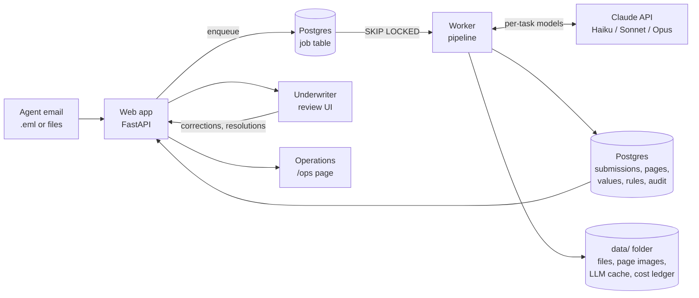
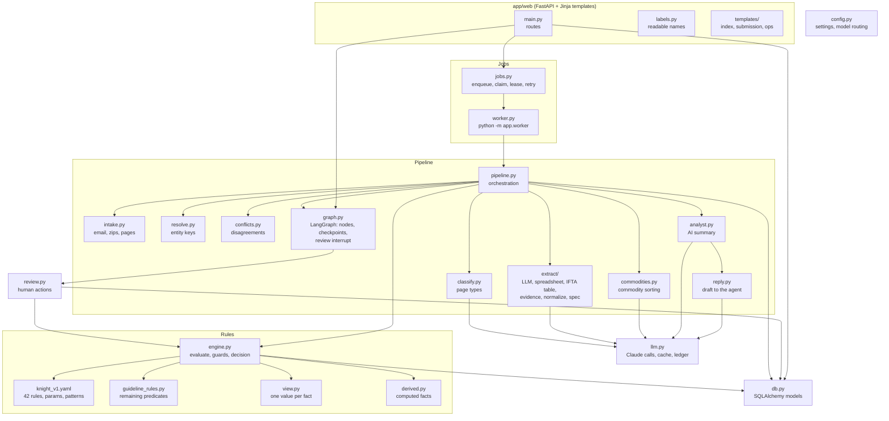
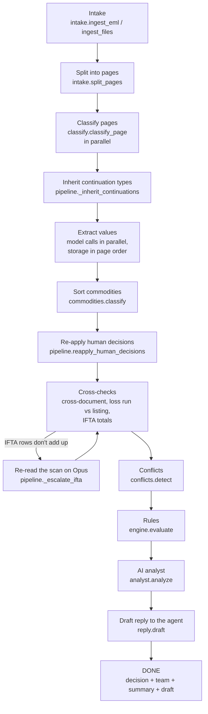
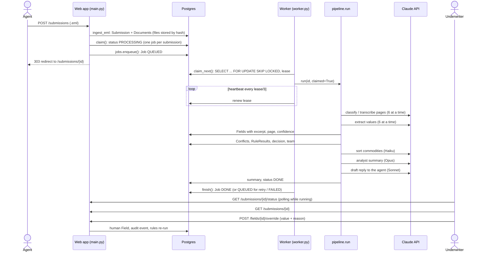
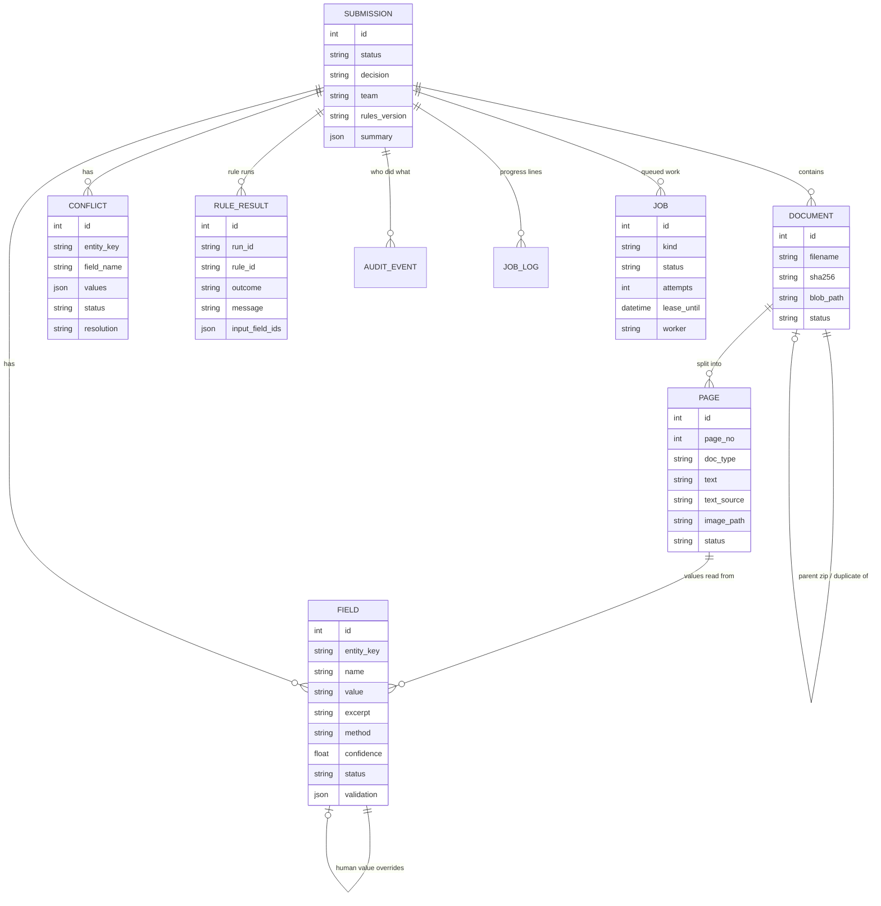
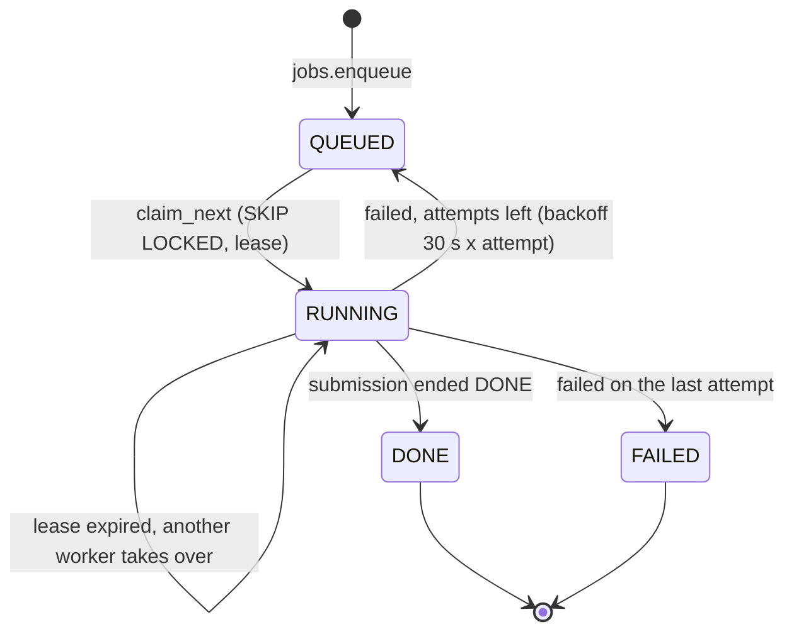
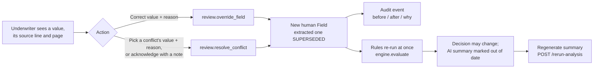
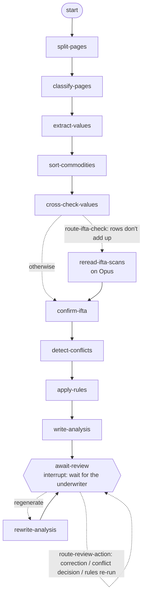
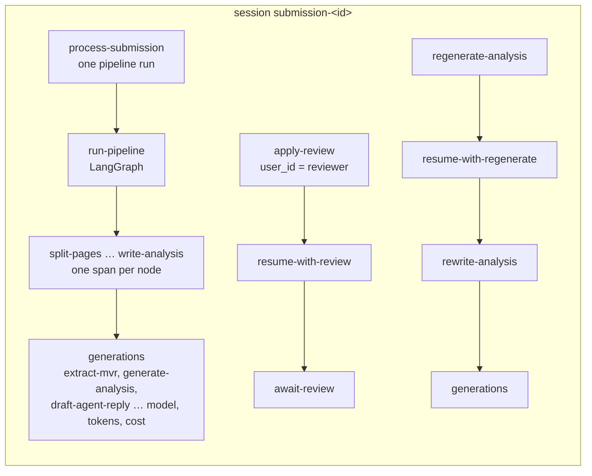

# Architecture

How Knight Intake turns an agent's email into an underwriting decision an underwriter can check. Everything here
describes code in this repository. Where something is *designed but not built*, it says so.

- [1. System overview](#1-system-overview)
- [2. Components](#2-components)
- [3. The pipeline, stage by stage](#3-the-pipeline-stage-by-stage)
- [4. Data model](#4-data-model)
- [5. Jobs, workers and reliability](#5-jobs-workers-and-reliability)
- [6. Human review loop](#6-human-review-loop)
- [7. Models per task and cost control](#7-models-per-task-and-cost-control)
- [8. Key design decisions and trade-offs](#8-key-design-decisions-and-trade-offs)
- [9. Built vs designed](#9-built-vs-designed)
- [10. What the underwriter sees first](#10-what-the-underwriter-sees-first)

---

## 1. System overview

An insurance agent emails a commercial-auto (trucking) submission: an application, driver and vehicle lists,
motor-vehicle records (MVRs), loss runs, fuel-tax (IFTA) returns, sometimes photos and handwritten notes. Knight
Intake:

1. **Unpacks** the email and its attachments (zips, PDFs, spreadsheets, Word files, images, the email body).
2. **Classifies every page by its content**, never by file name.
3. **Extracts values with evidence**: each value keeps the exact line it was read from, the page, and a confidence.
4. **Checks** the values in code (VIN check digits, IFTA rows adding up, agreement across documents).
5. **Finds conflicts** between documents and leaves them open for a person.
6. **Applies the Knight guideline as 42 deterministic rules**, which produce the decision and the routing.
7. **Writes an advisory AI summary** (concerns, next actions) that cites the values it relies on.
8. **Shows it all** in a web app where an underwriter can correct values, resolve conflicts and re-run the rules.

> The AI reads documents and advises. **It never decides.** The decision comes from versioned rules over values a
> person can inspect and override.

## 2. Components

| Layer | Modules | Responsibility |
|---|---|---|
| Web | `app/web/main.py`, `labels.py`, `templates/` | Upload, submission page, operations page, review actions, status polling |
| Jobs | `app/jobs.py`, `app/worker.py` | A job table on Postgres; workers claim jobs with leases and retries |
| Pipeline | `app/pipeline.py`, `intake.py`, `classify.py`, `extract/`, `commodities.py`, `resolve.py`, `conflicts.py`, `analyst.py`, `reply.py` | Email → decision, one stage at a time |
| Rules | `app/rules/` | The guideline as YAML config plus one Python predicate per rule |
| Review | `app/review.py` | Overrides and conflict resolutions as audited, re-applied "human" values |
| Platform | `app/llm.py`, `db.py`, `config.py`, `log.py` | Model calls, persistence, settings, structured and PII-masked logs |

## 3. The pipeline, stage by stage

`pipeline.run(submission_id)` executes these stages in order. Each stage writes a progress line that the UI shows
live.

### Run-time execution path (one submission)

### What each stage does

| Stage | Where | What goes in | What comes out |
|---|---|---|---|
| Intake | `intake.ingest_eml` / `ingest_files`, `_add_file`, `_unpack_zip`, `_unpack_email` | Raw email bytes, or uploaded files with an optional sender and note | A `Submission`; one `Document` per attachment, zip member, email found inside the submission (forwarded or zipped), and the email body or upload note (`email-body.txt`); duplicates by SHA-256 marked `DUPLICATE` |
| Split | `intake.split_pages` | A stored file | `Page` rows: PDF pages (text layer + 150 dpi image), XLSX sheets (cell dump), Word body, text, or one image (phone photos turned upright and resized) |
| Classify | `classify.classify_page` | Page text or image | `doc_type` (APPLICATION, MVR, LOSS_RUN, IFTA_RETURN, …), confidence, reason. Text: content signatures first, model if needed. Images: one vision call that classifies **and transcribes** |
| Extract | `pipeline._page_facts`, `extract/` | A classified page | Facts `{entity, field, value, excerpt}`. Spreadsheets parsed in code; scanned IFTA tables parsed in code; everything else by a schema-driven model call |
| Score | `extract/evidence.score` | Fact + page text | Confidence = method prior × excerpt-on-page × value-in-excerpt × validators |
| Resolve | `resolve.assign_keys` | Facts | Stable entity keys: `driver:<license>`, `vehicle:<VIN>`, `loss_run:<line>:<policy>`, `ifta:<quarter>`, … |
| Cross-check | `pipeline._cross_document_confirmation`, `_loss_runs_confirmed_by_listing`, `_ifta_reconciliation` | All values | Confidence raised where independent documents agree; IFTA returns confirmed only if rows add up to the printed total |
| Conflicts | `conflicts.detect` | All active values | `Conflict` rows (OPEN), each with every source value and a suggested one: the value most documents agree on; on a tie, the more authoritative document (MVR > application > license photo, loss run, IFTA > driver/vehicle lists > quote form); for a vehicle's make, the VIN |
| Rules | `rules/engine.evaluate` | `SubmissionView` (one value per fact) | 42 `RuleResult` rows, decision, team |
| Commodities | `commodities.classify` | Commodity names | A `prohibited_category` value per commodity with a reason; the rules compare it with the keyword (D-49) |
| Analyst | `analyst.analyze` | Values, conflicts, rule results, email body | Summary, concerns and next actions, each with cited ids (citations checked in code) |
| Draft reply | `reply.draft` | Decline reasons, unchecked items, open disagreements, analyst's actions for the agent (chosen in code) | An editable email to the agent; codes removed; never sent (D-48) |

## 4. Data model

Rules of the data:

- **Nothing is overwritten.** A re-run marks earlier values `REPLACED`; a human decision is a new `Field` with
  `method="human"`, and the extracted value it replaces becomes `SUPERSEDED`. Rule runs keep their history
  (`run_id`), so the page can show what changed ("was REFER").
- **Every rule result stores the field ids it relied on** (`input_field_ids`) and the rules version, so a decision can
  be traced to the exact values and the exact rules file.
- Files live in `data/blobs/` by content hash; paths are stored relative to `DATA_DIR` (`config.stored_path`).

## 5. Jobs, workers and reliability

Two modes, set by `JOB_MODE`:

| Mode | Used by | How a job runs |
|---|---|---|
| `thread` (default) | a plain local `uvicorn` run | the web process starts a background thread |
| `queue` | `docker-compose.yml` | the web app only enqueues; `worker` containers run jobs |

- **One active job per submission**: `pipeline.claim` is an atomic conditional `UPDATE`; a second start gets HTTP 409.
- **No double processing**: `SELECT … FOR UPDATE SKIP LOCKED` means two workers never take the same job.
- **A dead worker doesn't lose work**: it stops renewing its lease; once the lease runs out another worker takes the
  job over. This was tested by killing a worker mid-run (RUN_LOG QU1). A failed renewal (a database hiccup) is logged and
  retried, not fatal to the heartbeat; `docker compose kill -s SIGUSR1 worker` prints every thread's stack to the log
  to see where a stuck worker waits (D-53).
- **Retries**: up to `JOB_MAX_ATTEMPTS` (3), with a growing delay, then FAILED with the reason.
- **Restart**: at web startup, a submission still PROCESSING *without* a queued job is marked INTERRUPTED.
- **Inside one job**, classification and extraction calls run `LLM_CONCURRENCY` (6) at a time on plain copies of the
  pages; database writes stay on the job's own thread, in page order (`pipeline._parallel`). Measured: the sample
  took 97 s instead of 290 s at the same cost (RUN_LOG PAR1).

## 6. Human review loop

With `PIPELINE_ENGINE=graph` (Docker's default) the loop below runs **inside the LangGraph run**: the graph pauses at
`await-review` after the analysis, and each action resumes it (section 11). Older submissions, or the `code` engine,
call the same review functions directly.

Human decisions are keyed by `(entity_key, field)`, not by row id, so they **survive a full reprocess**
(`pipeline.reapply_human_decisions`). Edits are refused while a job is running (`review._not_processing`).

## 7. Models per task and cost control

| Task (tier) | Default model | Why this model |
|---|---|---|
| Classify text pages | Haiku 5.5 | Most pages are decided by content signatures in code; the model is a fallback |
| Transcribe scans and photos | Sonnet 5.5 | Only partly checkable by code, so a stronger model |
| Extract values | Haiku 5.5 | Every value is checked against the page; failures escalate |
| AI analyst | `CLAUDE_MODEL` (Opus 5.5) | Judgment, read by a person |
| Sort commodities | Haiku 5.5 | A short list, compared with keywords in the rules; unsure results ask a person |
| Draft reply to the agent (draft) | Sonnet 5.5 | Wording only; code chose the content and a person sends it |

**Escalation** (`pipeline._llm_extract`, `classify.classify_page`, `pipeline._escalate_ifta`): a cheap-tier result is
re-run on Opus when it fails a code check: a model error, no values, missing key fields, more than 20% of excerpts not
found on the page, a page marked unreadable, or IFTA rows not adding up.

**Cost controls**: content signatures before any model call; spreadsheets and scanned IFTA tables parsed in code;
the analyst gets aggregates computed in code; every request is cached by its exact content (`data/llm_cache/`);
every call is logged with its cost (`data/llm_usage.jsonl`, `scripts/cost_report.py`). Measured: about **$0.55–0.62
per sample submission** versus $2.37 with Opus everywhere.

## 8. Key design decisions and trade-offs

Each one is recorded in `DECISIONS.md` with the options and the reason.

| Decision | Chosen | Trade-off |
|---|---|---|
| Who decides (D-12) | Deterministic rules; the model only reads and advises | Rules can't use judgment; the analyst covers that, advisory only |
| Where more AI goes (D-48, D-49) | Where keywords or templates fail on meaning: commodity sorting, the agent reply. The model suggests; code compares, a person confirms | Two more calls (about $0.01 a submission) |
| Unknown inputs (D-22, D-39) | "Not evaluated" refers, never passes; a page that couldn't be read is never reported as "missing" | More referrals than a system that guesses |
| Outside data (D-39) | SAFER, border distance and the quoted premium are **VERIFY**: "ready to quote, after checks" | The final yes needs a person's lookup |
| Confidence (D-14) | Computed in code (method × evidence × validators), not the model's self-rating | Starting priors; would be calibrated from real overrides |
| Low confidence (`engine._apply_guards`) | A rule never passes or declines on a low-confidence value; a decline needs cited evidence | Scans and photos refer more often until confirmed |
| Conflicts (D-11) | Surfaced with every source value, left OPEN for a person | More review work, no silent wrong merges |
| Normalization (D-24) | Normalize for comparison, never overwrite source values | Two representations of each value |
| Rules as config (D-12, PLAN §5b) | YAML (thresholds, keyword lists, outcomes) + one Python function per rule | Engineers still change logic; a rules UI is designed only |
| Model per task (D-31) | Haiku / Sonnet / Opus by how checkable the task is, with escalation | More moving parts than one model |
| Orchestration (D-51) | LangGraph graph over the same stage functions; review as interrupt/resume; LangChain client for model calls | Two more dependencies; kept switchable to plain code, and proven equivalent |
| Queue (D-04, D-25, D-36) | A job table on the same Postgres with SKIP LOCKED and leases | Not a managed queue; enough for this scale, SQS designed |
| Formats (D-13, D-37, D-38, D-40) | PDF, XLSX, Word, text, images, zips, the email body; others flagged UNSUPPORTED with the reason | TIFF, HEIC, `.doc`, `.msg` not read |

## 9. Built vs designed

| Built and verified | Designed only (see PLAN.md §5a) |
|---|---|
| Email-file intake (upload of `.eml`, or files with a sender and note; emails inside zips or forwarded are opened) | A real mailbox (SES / Graph API) feeding the same intake |
| Postgres 18, Docker Compose (app, workers, database) | Managed database, object storage, secrets manager |
| Job table with SKIP LOCKED, leases, retries, takeover | SQS or another managed queue, autoscaling on queue depth |
| Per-task models, escalation, cache, cost ledger | Batch API, dashboards and alerts on the ledger |
| 42 rules, guards, VERIFY, audit log, human overrides | A rules editor for underwriting operations |
| Single reviewer identity, PII-masked logs | SSO, role-based access, encryption keys per tenant |
| — | FMCSA SAFER lookup, route data for the border check |

## 10. What the underwriter sees first

The submission page is ordered for review (D-41 to D-43):

- **Decision and team**, then **To review**: everything that needs a person, grouped as reasons to refer or decline,
  documents that disagree (each value with the document it came from), verify before quoting, and couldn't be checked.
  Messages are written for an underwriter; rule codes appear only in Rule checks and the audit log, with a legend
  (*What the rule codes mean*).
- **Conflicts** show every source value and a suggestion (and say how it was chosen). Where there's nothing to choose
  (a claim on an unscheduled vehicle or driver, a listed term without a loss run), the page gives the next step and the
  underwriter acknowledges it with a note.

## 11. LangGraph and LangChain (D-51)

The stages in section 3 are plain functions (`pipeline.STAGES`). With `PIPELINE_ENGINE=graph` they run as a LangGraph
`StateGraph` (`app/graph.py`); this diagram is what `graph.mermaid()` draws from the compiled graph:

| LangGraph feature | Used for | Notes |
|---|---|---|
| Nodes | One per stage, each with its own session, committed after the node | The `code` engine runs the identical functions in the same order (tested) |
| Conditional edge | IFTA returns whose rows don't add up go through `escalate_ifta` | Skipped when the transcribe tier is already the escalation model |
| Checkpointer | `PostgresSaver` on the app's Postgres (tables `checkpoints`, `checkpoint_writes`); `InMemorySaver` with SQLite | The run's small state (`known_drivers`, `failed_ifta`, `last_action`) is saved after every node; thread `submission-<id>` |
| `interrupt()` / `Command(resume=…)` | Human review: the run pauses after the analyst and waits, durably, for the underwriter | Web actions resume it synchronously; a regenerate resumes it in a worker; a refused action is recorded and reported, not raised (a raising node would replay it on the next resume) |

What stays outside the graph, on purpose: the **job queue** still decides which worker runs a job and takes over a
crashed one (a reprocess deletes the thread and starts over, as before); the **cache and cost ledger** stay in
`llm.structured_call`.

**LangChain:** with `LLM_CLIENT=langchain`, a cache miss is sent by `ChatAnthropic` (langchain-anthropic) instead of the
SDK call. Tests prove the payload is byte-identical (system prompt, content and image blocks, `output_config` with effort
and JSON schema, fallback betas and `extra_body`); the cache key is computed before either client, so cached answers
are shared and every ledger line records which client sent it.

**Proof of equivalence** (RUN_LOG LG1): the five eval sets reprocessed through the graph hit the cache on every
page-level call and kept every score; a fully live run of held-out #3 through LangGraph and LangChain scored 69/69.
**Rollback:** `PIPELINE_ENGINE=code`, `LLM_CLIENT=sdk`. These are kept on purpose (D-53): both engines run the same stage
functions and both clients send the same request, so the switches cost a few lines and are tested.

## 12. Observability with Langfuse (D-52)

Tracing is on when `LANGFUSE_PUBLIC_KEY` and `LANGFUSE_SECRET_KEY` are set (`LANGFUSE_BASE_URL` picks the region or
a self-hosted server); `app/tracing.py` holds all of it. It follows Langfuse's "what does a good trace look like":
one trace per unit of work, a session for work with human steps in between, verb-first stable names, safe and
meaningful input/output, and model, tokens and cost on every generation.

| Trace | When | Input / output | Scores (from our own code checks) |
|---|---|---|---|
| `process-submission` | Every pipeline run | email subject and file count / decision, team, rule outcome counts | `evidence-verified-rate`, `low-confidence-values`, `ifta-unreconciled`, `escalations`, `commodity-disagreements`, `analyst-unsupported-items`, `open-conflicts`, `run-cost-usd`, `cache-hit-rate`, `decision`, `analyst-ok` |
| `apply-review` | Each correction, conflict decision, rules re-run (a refusal is a WARNING) | kind, field, document type / new decision | `review-action`, `corrected-field`, `decision-changed` |
| `regenerate-analysis` | Each regenerate | submission / written or failed | — |

Nodes and model calls come from Langfuse's LangChain integration (`CallbackHandler`, bound to our client) on every
graph invocation; with `PIPELINE_ENGINE=code` or `LLM_CLIENT=sdk` the same spans and generations are created by
hand. Every trace carries `session_id = submission-<id>`, the environment (`docker` in Compose), tags
(`pipeline`, `review`, `regenerate`, `engine:*`) and metadata (engine, client).

**Privacy.** Prompts and outputs contain driver names, licence numbers and dates of birth. A `mask_otel_spans` hook
rewrites every exported span: model inputs and outputs become "[not captured: N characters]"; graph node state keeps
only the submission id, failed IFTA quarters and the review action's kind ("12 drivers (not captured)"); router
choices (the next node's name) are kept; our own summaries are kept. `LANGFUSE_CAPTURE_CONTENT=true` sends content,
PII-masked like the logs. Tests export to memory and never contact Langfuse.

**Dashboard** (`scripts/langfuse_dashboard.py`, created through Langfuse's dashboards API): three rows, three
questions. (1) What does a submission cost, and where does the money go: cost per run, cost by task, cost by model,
p95 run time. (2) Can we trust what the AI read: share of quoted lines verified on the page, low-confidence values
per run, check failures by kind, cache share. (3) Where do people step in: fields underwriters corrected, review
actions, decisions, share of reviews that changed the decision.
